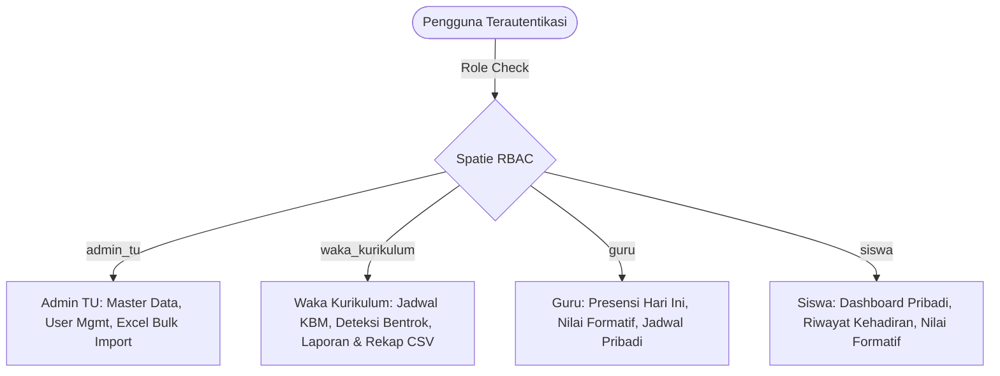

# SmartAkademik — MAN 4 Jombang

<p align="center">
  
  <br>
  <strong>Platform Operasional Akademik & Presensi Harian Siswa Berbasis Mobile-First</strong>
  <br>
  <em>MAN 4 Jombang PP. Mamba'ul Ma'arif Denanyar, Jombang, Jawa Timur</em>
</p>

<p align="center">
  
  
  
  
  
</p>

---

## 1. Tentang SmartAkademik

**SmartAkademik** adalah sistem informasi manajemen operasional akademik dan presensi kelas harian yang dirancang khusus untuk memfasilitasi kegiatan belajar mengajar (KBM) di **MAN 4 Jombang**.

### Posisi & Batasan Sistem (System Positioning)
> **PENTING:** SmartAkademik merupakan **layer operasional harian sekolah**, BUKAN pengganti sistem resmi Kementerian Agama (EMIS / SIMPATIKA / eRapor).

- **Fokus Utama:** Pencatatan kehadiran siswa per jam pelajaran (JP), pencatatan nilai formatif harian (tugas, kuis, ulangan harian), pemantauan jadwal pelajaran interaktif, dan rekap analitik waka kurikulum.
- **Nilai Formatif vs. eRapor:** Nilai yang terekam pada sistem ini adalah nilai formatif harian pendukung proses pembelajaran. Nilai akhir semester tetap diinput manual ke eRapor resmi Kemenag.
- **Ekosistem Digital Sekolah:** Tidak menduplikasi sistem lain yang sudah aktif di MAN 4 Jombang (CBT, Perpustakaan Digital, dan Website Profil Madrasah).

---

## 2. Fitur Utama Berdasarkan Peran (Role-Based Features)

SmartAkademik menerapkan Role-Based Access Control (RBAC) ketat berbasis 4 peran pengguna:



### 1. Administrator Tata Usaha (`admin_tu`)
- **Master Data Management:** Pengelolaan data Siswa, Guru, Rombongan Belajar (Kelas), dan Mata Pelajaran (Mapel).
- **Import Massal Excel:** Import terstruktur data siswa, guru, kelas, dan mapel dengan validasi per baris, isolasi transaksi, dan pembuatan akun pengguna otomatis.
- **User & Role Management:** Manajemen akun pengguna madrasah, penetapan role, dan reset kredensial.
- **Pengaturan Akademik:** Konfigurasi semester aktif, tahun ajaran, dan durasi KBM.

### 2. Waka Kurikulum (`waka_kurikulum`)
- **Manajemen Jadwal Pelajaran Terpadu:** Pengaturan jadwal KBM lintas rombel dan guru.
- **Deteksi Bentrok Otomatis (Automated Conflict Detection):** Validasi real-time untuk mencegah jadwal guru bentrok pada slot waktu bersamaan dan jadwal kelas bentrok pada slot yang sama.
- **Laporan Analitik Akademik ($O(1)$ Optimized):** Agregasi performa presensi dan ketuntasan nilai formatif per rombel tanpa $N+1$ query.
- **Export Rekap Presensi & Nilai (CSV):** Unduh rekapitulasi kehadiran dan nilai siswa siap cetak/olah.

### 3. Guru Pengampu (`guru`)
- **Presensi Kelas Hari Ini (Locked to Today):** Pencatatan absensi siswa (Hadir, Izin, Sakit, Alfa) yang terkunci strictly pada hari KBM aktif untuk menjamin integritas data (anti back-dating).
- **Batas Jadwal Mengajar Pribadi:** Guru hanya dapat mengakses dan mengabsen siswa pada jadwal kelas yang diampunya sendiri (`guru/jadwal` terisolasi).
- **Penilaian Formatif Terstruktur:** Input nilai tugas dan ulangan harian per tujuan pembelajaran.
- **Mobile-First UX:** Tata letak dan tombol sentuh (touch target $\ge 44\text{px}$) optimal untuk penggunaan langsung di ruang kelas via smartphone.

### 4. Siswa (`siswa`)
- **Dashboard Ringkasan Pribadi:** Pantau persentase kehadiran riil, total ketidakhadiran, dan rata-rata nilai formatif.
- **Riwayat Presensi Transparan:** Detail status kehadiran per tanggal dan jam pelajaran.
- **Kartu Nilai Formatif:** Akses transparan terhadap hasil evaluasi harian mata pelajaran.

---

## 3. Arsitektur Teknologi (Tech Stack)

| Lapisan | Teknologi | Deskripsi |
|---|---|---|
| **Backend Framework** | Laravel 13.x | PHP ^8.3 dengan Eloquent ORM & Strict Types |
| **Reactivity Layer** | Livewire 3.x | Single-Page experience tanpa API boilerplate |
| **Frontend Styling** | Tailwind CSS 3.4 | Atomic CSS dengan semantic design token |
| **Authentication & RBAC** | Laravel Breeze & Spatie Permission | Multi-role protection pada route dan method level |
| **Database** | SQLite (Dev/Test) / MySQL (Production) | Transaksional ACID dengan composite unique constraints |
| **Timezone** | `Asia/Jakarta` (WIB, UTC+7) | Penyelarasan waktu madrasah Jombang |
| **Build Tooling** | Vite 5.x | HMR cepat dan bundle css/js teroptimasi |
| **Quality Assurance** | PHPUnit 12 & Custom Discipline Script | Pengujian fitur/unit dengan pengujian non-vacuity |

---

## 4. Persyaratan Sistem (Prerequisites)

Sebelum menjalankan aplikasi di lingkungan lokal atau server produksi, pastikan komponen berikut telah terpasang:
- **PHP** $\ge$ 8.3 (ekstensi wajib: `pdo_sqlite`, `pdo_mysql`, `mbstring`, `xml`, `curl`, `zip`, `fileinfo`)
- **Composer** $\ge$ 2.6
- **Node.js** $\ge$ 18.x dan **NPM** $\ge$ 9.x
- **Git**

---

## 5. Panduan Instalasi Lokal (Setup Guide)

Ikuti langkah-langkah berikut untuk menjalankan SmartAkademik secara lokal:

### 1. Kloning Repositori
```bash
git clone https://github.com/MasRizqi07/smartakademik.git
cd smartakademik
```

### 2. Instalasi Dependensi PHP & Node.js
```bash
composer install
npm install
```

### 3. Konfigurasi Lingkungan (`.env`)
Salin file template lingkungan dan buat kunci aplikasi:
```bash
cp .env.example .env
php artisan key:generate
```

Pastikan variabel timezone madrasah terpasang di `.env`:
```ini
APP_NAME=SmartAkademik
APP_ENV=local
APP_KEY=base64:...
APP_DEBUG=true
APP_URL=http://localhost:8000
APP_TIMEZONE=Asia/Jakarta

DB_CONNECTION=sqlite
# Jika menggunakan MySQL di production:
# DB_CONNECTION=mysql
# DB_HOST=127.0.0.1
# DB_PORT=3306
# DB_DATABASE=smartakademik
# DB_USERNAME=root
# DB_PASSWORD=secret
```

### 4. Migrasi Database dan Seeding Data Uji
Jalankan migrasi tabel dan seeder data awal (termasuk role, akun pengujian, rombel, guru, dan mata pelajaran):
```bash
# Untuk SQLite pastikan file database tersedia jika belum ada:
# Windows PowerShell:
New-Item -ItemType File -Path database\database.sqlite -Force

php artisan migrate:fresh --seed
```

### 5. Kompilasi Aset Frontend
```bash
# Untuk pengembangan lokal:
npm run dev

# Atau build untuk mode produksi:
npm run build
```

### 6. Menjalankan Server Lokal
```bash
php artisan serve
```
Akses sistem di browser: **[http://127.0.0.1:8000](http://127.0.0.1:8000)**

---

## 6. Akun Uji Coba Bawaan (Default Test Credentials)

Setelah menjalankan `php artisan db:seed`, sistem menyediakan kredensial pengujian berikut:

| Peran | Email Login | Password Default | Keterangan / Akses |
|---|---|---|---|
| **Admin TU** | `admin@smartakademik.test` | `password` | Akses penuh master data & import Excel |
| **Waka Kurikulum** | `waka@smartakademik.test` | `password` | Manajemen jadwal & rekap analitik |
| **Guru 1** | `guru@smartakademik.test` | `password` | Budi Santoso, S.Pd. (Mapel Matematika) |
| **Guru 2** | `guru2@smartakademik.test` | `password` | Siti Aminah, M.Pd. (Mapel Fisika) |
| **Siswa** | `siswa@smartakademik.test` | `password` | Siswa kelas X-A (Riwayat presensi & nilai) |

---

## 7. Pengujian & Kualitas Kode (Quality Assurance)

Proyek ini dilengkapi dengan suite pengujian otomatis yang komprehensif untuk memastikan reliabilitas dan kepatuhan sistem:

### Menjalankan Seluruh Test Suite (PHPUnit)
```bash
# Menjalankan seluruh pengujian unit & fitur (95 tests, 376 assertions)
php artisan test
```

### Menjalankan Audit Disiplin Desain UI
Script audit mendeteksi pelanggaran warna arbitrer, dekorasi non-standar, dan hardcoded metrics:
```bash
# Git Bash / Linux:
bash scripts/check-discipline.sh

# Windows PowerShell:
& "C:\Program Files\Git\bin\bash.exe" scripts/check-discipline.sh
```
*Hasil yang diharapkan: `raw_hues_live=0`, `decoration_live=0`, `static_numeric_literals_live=0`, `exit_code=0`.*

### Dokumentasi Terkait
- [Arsitektur Sistem (ARCHITECTURE.md)](file:///d:/MY%20CODE/ANTIGRAVITY/PHP/smartakademik/docs/ARCHITECTURE.md)
- [Pedoman Sistem Desain UI/UX (DESIGN.md)](file:///d:/MY%20CODE/ANTIGRAVITY/PHP/smartakademik/docs/DESIGN.md)
- [Panduan Pengujian untuk Tim QA (QA_REVIEW_GUIDE.md)](file:///d:/MY%20CODE/ANTIGRAVITY/PHP/smartakademik/docs/QA_REVIEW_GUIDE.md)
- [Buku Panduan Pengguna (USER_MANUAL.md)](file:///d:/MY%20CODE/ANTIGRAVITY/PHP/smartakademik/docs/USER_MANUAL.md)

---

## 8. Lisensi & Hak Cipta

Dikembangkan untuk lingkungan operasional pendidikan **MAN 4 Jombang PP. Mamba'ul Ma'arif Denanyar Jombang**. Hak Cipta &copy; 2026 SmartAkademik. Berlisensi di bawah [MIT License](LICENSE).
