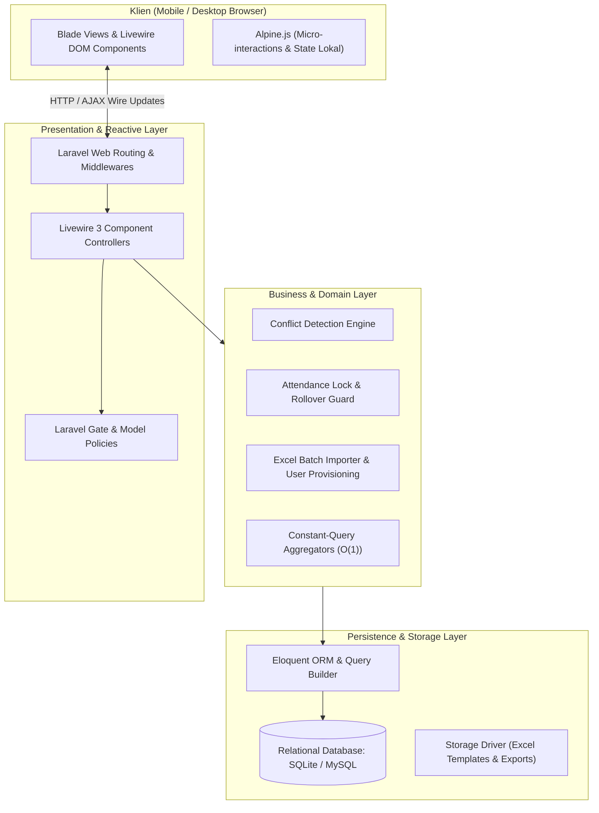
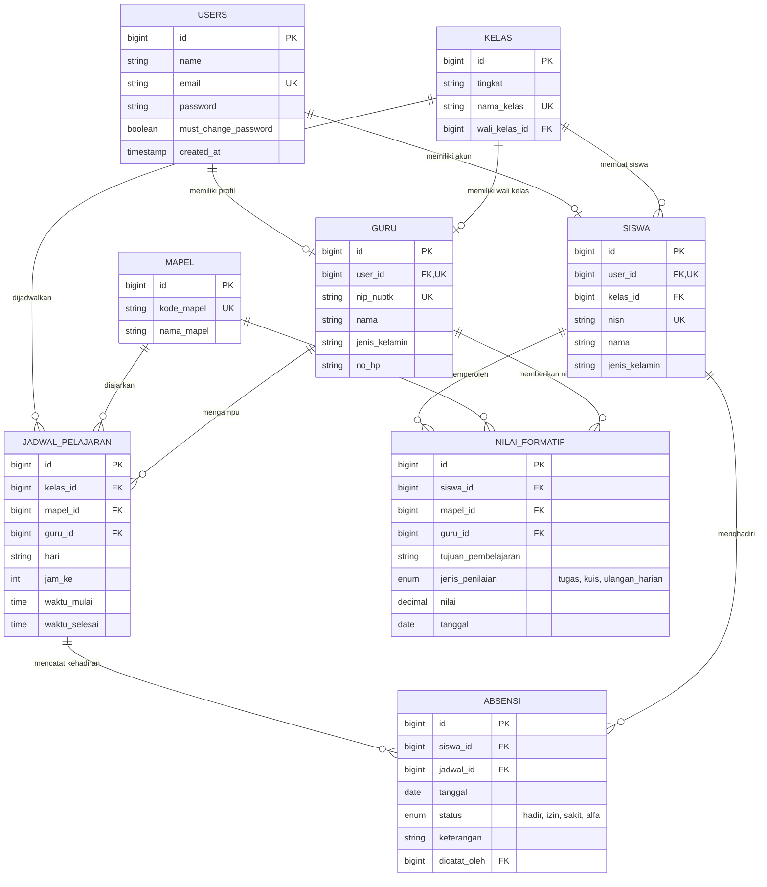

# Arsitektur Sistem — SmartAkademik MAN 4 Jombang

Dokumen ini mendokumentasikan arsitektur teknis, desain data, model otorisasi, dan strategi performa dari sistem informasi akademik **SmartAkademik**. Dokumen ini ditujukan untuk **Technical Lead, Software Architect, QA Reviewer, dan Pengembang**.

---

## 1. Ikhtisar Arsitektur (High-Level Architecture)

SmartAkademik dibangun di atas arsitektur monolitik modern yang reaktif (**Modern Reactive Monolith**) memanfaatkan ekosistem **Laravel 13**, **Livewire 3**, dan **Tailwind CSS**. Arsitektur ini dipilih untuk meminimalkan latensi jaringan dan kompleksitas state synchronization tanpa perlu memisahkan backend API dan frontend SPA.



---

## 2. Model Entitas & Diagram Relasi Data (ERD)

Struktur data SmartAkademik dirancang dengan normalisasi relasional ketat dan composite unique constraints untuk menjamin integritas data pada level database.



### Constraint Penting pada Database:
1. **Pencegahan Double-Entry Presensi:**
   Tabel `absensi` memiliki constraint unik komposit pada `(siswa_id, jadwal_id, tanggal)`. Seorang siswa tidak dapat memiliki lebih dari satu status kehadiran pada sesi dan hari yang sama.
2. **Pencegahan Bentrok Jadwal Mengajar (Guru):**
   Constraint unik komposit pada `jadwal_pelajaran` di level `(guru_id, hari, jam_ke)` memastikan seorang guru tidak dapat dijadwalkan di dua kelas pada jam yang sama.
3. **Pencegahan Bentrok Jadwal Kelas (Rombel):**
   Constraint unik komposit pada `jadwal_pelajaran` di level `(kelas_id, hari, jam_ke)` memastikan sebuah rombel tidak memiliki dua pelajaran berbeda pada jam pelajaran yang sama.

---

## 3. Arsitektur Otorisasi & Pertahanan Berlapis (Defense-in-Depth RBAC)

SmartAkademik menerapkan 4 lapisan otorisasi independen untuk mencegah eskalasi hak akses (*privilege escalation*) dan mutasi data ilegal:

```
[Layer 1: Route Middleware]  -->  Role validation (Spatie Permission)
       ↓
[Layer 2: Component Mount]   -->  Role check & Model Policy (authorize)
       ↓
[Layer 3: Query Scoping]     -->  Filter data spesifik milik pengguna (Multi-tenant style)
       ↓
[Layer 4: Method & Attribute]-->  #[Locked], abort_unless, & Rollover Security Guard
```

### Lapisan 1: Route Middleware
Seluruh rute diproteksi oleh middleware autentikasi dan pengecekan peran di [routes/web.php](file:///d:/MY%20CODE/ANTIGRAVITY/PHP/smartakademik/routes/web.php):
- `/admin/*` $\rightarrow$ `role:admin_tu`
- `/waka/*` $\rightarrow$ `role:waka_kurikulum`
- `/guru/*` $\rightarrow$ `role:guru`
- `/siswa/*` $\rightarrow$ `role:siswa`

### Lapisan 2: Komponen Mount & Policy Authorization
Komponen Livewire mengeksekusi pemeriksaan otorisasi formal menggunakan Laravel Policy:
```php
// Contoh pada AbsensiGuru.php & NilaiGuru.php
$jadwal = JadwalPelajaran::findOrFail($this->selectedJadwalId);
$this->authorize('create', [Absensi::class, $jadwal]);
```
Kebijakan `AbsensiPolicy` memvalidasi bahwa `auth()->user()->guru->id === $jadwal->guru_id` atau user memiliki peran administrator.

### Lapisan 3: Query Scoping (Schedule Isolation)
Pada [app/Livewire/Waka/JadwalManager.php](file:///d:/MY%20CODE/ANTIGRAVITY/PHP/smartakademik/app/Livewire/Waka/JadwalManager.php), ketika diakses oleh peran guru (`isOwnScheduleOnly()`), query secara otomatis dikunci:
```php
if ($isOwn) {
    $guru = auth()->user()->guru;
    $ownGuruId = $guru ? $guru->id : 0;
    $query->where('guru_id', $ownGuruId);
}
```
Jika akun guru belum terhubung dengan record profil `Guru`, nilai `guru_id = 0` diterapkan sehingga tidak ada data jadwal sekolah yang bocor. Dropdown guru lain dan mapel lain dikosongkan (`collect()`).

### Lapisan 4: Penguncian Properti & Proteksi Pergantian Hari (Rollover Guard)
Untuk mencegah backdating atau manipulasi tanggal presensi dari sisi klien:
```php
use Livewire\Attributes\Locked;

#[Locked]
public $tanggal = '';
```
Atribut `#[Locked]` menolak upaya mutasi properti dari request JSON Livewire (menghasilkan `CannotUpdateLockedPropertyException`). Selain itu, seluruh metode mutasi (`setPresence`, `markAllHadir`, `resetAll`, `saveNote`, `save`) memanggil guard waktu riil:
```php
abort_unless($this->tanggal === today()->toDateString(), 422, 'Tanggal presensi hanya boleh hari ini. Muat ulang halaman.');
```
Jika sesi dibuka sebelum pukul 23:59 WIB lalu mutasi dikirim setelah pukul 00:01 WIB, permintaan langsung dibatalkan dengan kode HTTP 422.

---

## 4. Rekayasa Performa & Agregasi Konstan ($O(1)$ Complexity)

Salah satu kelemahan umum aplikasi akademik adalah timbulnya query $N+1$ pada laporan dan rekapitulasi nilai ketika jumlah siswa atau kelas meningkat. SmartAkademik menerapkan strategi optimasi berikut:

### Solusi Masalah $N+1$ pada Laporan Akademik
Pada [app/Livewire/Waka/LaporanAkademik.php](file:///d:/MY%20CODE/ANTIGRAVITY/PHP/smartakademik/app/Livewire/Waka/LaporanAkademik.php), perhitungan persentase kehadiran dan ketuntasan KKM tidak dijalankan secara iteratif per baris kelas. Sebagai gantinya, digunakan agregasi SQL konstan dalam satu query:

```php
$absensiStats = Absensi::join('siswa', 'absensi.siswa_id', '=', 'siswa.id')
    ->whereIn('siswa.kelas_id', $kelasIds)
    ->select(
        'siswa.kelas_id',
        DB::raw('COUNT(*) as total_absensi'),
        DB::raw("SUM(CASE WHEN absensi.status = 'hadir' THEN 1 ELSE 0 END) as total_hadir")
    )
    ->groupBy('siswa.kelas_id')
    ->get()
    ->keyBy('kelas_id');
```
Dengan pola ini, jumlah query ke database tetap konstan berjumlah 3 query terlepas dari apakah madrasah memiliki 5 kelas atau 50 kelas.

### Efisiensi Streaming Ekspor CSV
Ekspor rekapitulasi absensi dan analitik akademik tidak menumpuk seluruh baris dalam memory PHP (mencegah `Fatal error: Allowed memory size exhausted`). Sistem menggunakan `response()->stream()` yang langsung menulis baris demi baris ke stream output dengan menambahkan `UTF-8 BOM` (`\xEF\xBB\xBF`) agar file CSV terbuka rapi tanpa korupsi karakter di Microsoft Excel.

---

## 5. Sinkronisasi Zona Waktu (Timezone Alignment)

- Konfigurasi aplikasi diatur pada [config/app.php](file:///d:/MY%20CODE/ANTIGRAVITY/PHP/smartakademik/config/app.php):
  ```php
  'timezone' => env('APP_TIMEZONE', 'Asia/Jakarta'),
  ```
- MAN 4 Jombang berlokasi di Jombang, Jawa Timur (Waktu Indonesia Barat / UTC+7).
- Penerapan timezone `Asia/Jakarta` memastikan fungsi `today()->toDateString()` dan `now()` beroperasi akurat sesuai jam kerja madrasah, mencegah kesalahan pencatatan tanggal bagi guru yang menginput presensi pada jam pertama pukul 07:00 WIB.

---

## 6. Inventori Komponen Livewire

| Namespace | Nama Komponen | Kegunaan | Hak Akses |
|---|---|---|---|
| `App\Livewire\Admin` | `GuruManager` | Pengelolaan data guru & NIP | `admin_tu` |
| `App\Livewire\Admin` | `KelasManager` | Pengelolaan rombongan belajar & tingkat | `admin_tu` |
| `App\Livewire\Admin` | `MapelManager` | Pengelolaan mata pelajaran & kode | `admin_tu` |
| `App\Livewire\Admin` | `SiswaManager` | Pengelolaan data siswa & NISN | `admin_tu` |
| `App\Livewire\Admin` | `ImportExcel` | Bulk import multi-sheet Excel | `admin_tu` |
| `App\Livewire\Admin` | `UserRoleManager` | Manajemen user dan role Spatie | `admin_tu` |
| `App\Livewire\Admin` | `PengaturanManager` | Konfigurasi semester & KBM | `admin_tu` |
| `App\Livewire\Admin` | `EventUjianManager` | Kalender jadwal agenda ujian | `admin_tu`, `waka_kurikulum` |
| `App\Livewire\Waka` | `JadwalManager` | Penyusunan jadwal & deteksi bentrok | `admin_tu`, `waka_kurikulum`, `guru` (scoped) |
| `App\Livewire\Waka` | `LaporanAkademik` | Analitik performa kelas & KKM | `admin_tu`, `waka_kurikulum` |
| `App\Livewire\Waka` | `RekapAbsensi` | Rekapitulasi kehadiran bulanan | `admin_tu`, `waka_kurikulum` |
| `App\Livewire\Waka` | `RekapNilai` | Rekapitulasi nilai formatif siswa | `admin_tu`, `waka_kurikulum` |
| `App\Livewire\Guru` | `AbsensiGuru` | Pengambilan presensi terkunci hari ini | `guru` |
| `App\Livewire\Guru` | `NilaiGuru` | Input nilai formatif harian | `guru` |
| `App\Livewire\Guru` | `ProfilGuru` | Profil & rekap jam mengajar pribadi | `guru` |
| `App\Livewire\Siswa` | `SiswaDashboard` | Ringkasan kehadiran & nilai siswa | `siswa` |
