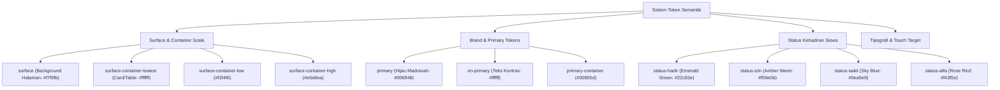

# Pedoman Desain & Sistem UI/UX — SmartAkademik MAN 4 Jombang

Dokumen ini mendefinisikan sistem desain, filosofi antarmuka pengguna (UI), arsitektur token semantik, standar komponen, dan aturan disiplin desain visual pada sistem **SmartAkademik**. Dokumen ini diperuntukkan bagi **UI/UX Designer, Frontend Engineer, QA Reviewer, dan Klien**.

---

## 1. Filosofi Desain (Design Philosophy)

SmartAkademik dirancang dengan prinsip **"Utilitarian Speed Over Frivolous Decoration"**:

1. **Efisiensi Input di Lapangan:**
   Seorang guru di ruang kelas harus mampu menyelesaikan presensi satu rombel (30–35 siswa) dalam waktu kurang dari 60 detik langsung dari ponsel pintar. Antarmuka harus meminimalkan jumlah tap, bukan menambahkan animasi atau dekorasi yang memperlambat alur kerja.
2. **Mobile-First Realitas Ruang Kelas:**
   Desain dibangun dari viewport terkecil **375px (lebar layar smartphone)** sebagai standar dasar, bukan antarmuka desktop yang sekadar dipersempit (*shrunk*).
3. **Keterbacaan & Sinyal Visual Instan:**
   Status absensi (*Hadir, Izin, Sakit, Alfa*) memiliki identitas warna dan ikonografi yang kontras dan langsung terbaca dalam sekali lirik (*instant scannability*).
4. **Netral & Profesional Institusional:**
   Sebagai alat kerja harian internal madrasah, antarmuka mengedepankan ketenangan visual, kontras yang memenuhi standar aksesibilitas WCAG AA, dan menghindari ornamen dekoratif berat.

---

## 2. Arsitektur Token Semantik (Semantic Token System)

Sistem styling SmartAkademik mengadopsi arsitektur token semantik **Material Design 3 (M3)** yang dikonfigurasi pada [tailwind.config.js](file:///d:/MY%20CODE/ANTIGRAVITY/PHP/smartakademik/tailwind.config.js).



### 2.1 Palet Warna Semantik Utama

| Token Semantik | Kode Hex | Peruntukan / Penggunaan |
|---|---|---|
| `bg-primary` | `#006948` | Warna identitas utama MAN 4 Jombang, tombol CTA primer, header aktif |
| `text-on-primary` | `#ffffff` | Teks di atas elemen `bg-primary` |
| `bg-primary-container`| `#00855d` | State hover pada tombol primer, container aksen |
| `bg-surface` | `#f7f9fb` | Latar belakang seluruh halaman aplikasi |
| `bg-surface-container-lowest` | `#ffffff` | Latar kartu (*card*), modal, dan container tabel |
| `bg-surface-container-low` | `#f2f4f6` | Header tabel data dan seksi input sekunder |
| `border-border-default` | `#e2e8f0` | Garis batas (*border*) kartu, input, dan pembatas baris |
| `text-text-main` | `#0f172a` | Warna teks utama untuk judul dan konten utama |
| `text-on-surface-variant`| `#3d4a42` | Teks sekunder, deskripsi bantuan, timestamp |

### 2.2 Token Status Presensi Siswa

Warna status presensi tidak boleh dipertukarkan untuk menjaga refleks visual guru:

```
┌──────────────┬──────────────┬──────────────┬──────────────┐
│    HADIR     │     IZIN     │    SAKIT     │     ALFA     │
│   #22c55e    │   #f59e0b    │   #0ea5e9    │   #f43f5e    │
│ status-hadir │ status-izin  │ status-sakit │ status-alfa  │
└──────────────┴──────────────┴──────────────┴──────────────┘
```

---

## 3. Kebijakan "Zero Raw Hues" & Disiplin Desain

Untuk menjaga konsistensi identitas visual dan mencegah regresi desain yang berantakan, SmartAkademik menerapkan aturan ketat yang diverifikasi otomatis via script [scripts/check-discipline.sh](file:///d:/MY%20CODE/ANTIGRAVITY/PHP/smartakademik/scripts/check-discipline.sh):

1. **Larangan Penggunaan Raw Utility Hues:**
   Dilarang menggunakan utility warna arbitrary Tailwind seperti `bg-blue-600`, `text-indigo-500`, atau `bg-purple-700` pada view aplikasi aktif. Seluruh styling wajib menggunakan token semantik (`primary`, `secondary`, `status-*`, `surface-*`).
2. **Larangan Dekorasi Arbitrer:**
   Dilarang menggunakan efek animasi berlebih, backdrop blur berat yang mengorbankan performa perangkat *low-end*, atau border ornamen non-standar.
3. **Larangan Hardcoded Metric Literals:**
   Seluruh angka analitik pada dashboard (persentase kehadiran, rata-rata nilai, total siswa) wajib merupakan data komputasi riil atau fallback `-` jika data belum tersedia. Dilarang menempatkan angka statis palsu seperti `95.5%` atau `85.0%`.

---

## 4. Sistem Tipografi & Skala Teks

SmartAkademik menggunakan jenis huruf modern **Plus Jakarta Sans** yang memiliki legibilitas tinggi pada layar sentuh:

| Skala / Kelas | Ukuran | Line Height | Penggunaan |
|---|---|---|---|
| `font-headline-lg` | 24px / 30px | 1.25 | Judul utama dashboard dan halaman modul |
| `font-headline-md` | 18px / 20px | 1.3 | Judul kartu seksi dan modal dialog |
| `font-label-md` | 14px | 1.4 | Teks tombol CTA, tab navigasi aktif |
| `font-body-default`| 14px | 1.5 | Teks isi default, sel tabel, keterangan |
| `text-xs` | 12px | 1.4 | Label formulir, pill status, timestamp |
| `text-[10px]` | 10px | 1.2 | Badge akronim, pill hari/jam kecil |

---

## 5. Standar Komponen Antarmuka (Component Library)

### 5.1 Baris Checklist Presensi (Attendance Roster Row)
Komponen paling sering digunakan guru di ruang kelas:
- **Tampilan 1 Siswa = 1 Baris Jelas:** Menampilkan nomor urut, NISN, nama lengkap siswa, dan 4 tombol status bertarget sentuh minimal $44\text{px}$.
- **Feedback Visual:** Tombol status yang aktif mendapatkan warna solid token status dengan teks kontras tinggi, sedangkan tombol tidak aktif menggunakan outline netral tipis.
- **Catatan Guru Modal:** Terdapat tombol catatan (*note icon*) untuk menyematkan keterangan sakit/izin khusus siswa secara instan.

### 5.2 Header Presensi & Tampilan Tanggal Hari Ini
- **Field Tanggal Read-Only:** Tanggal presensi ditampilkan dalam pill abu-abu lembut terformat lengkap (*"Senin, 13 Oktober 2026"*) dengan badge *"Hari Ini"*. Tidak menggunakan input kalender untuk mencegah kesalahan tanggal.
- **Mini KPI Counters:** 4 counter kecil di atas daftar siswa yang secara reaktif menghitung jumlah siswa *Hadir, Izin, Sakit,* dan *Alfa* saat tombol ditekan.

### 5.3 Filter & Pill Selector Hari
- Pill selector hari (*Semua Hari, Senin, Selasa, Rabu, Kamis, Jumat, Sabtu*) memungkinkan Waka dan Guru memfilter jadwal dengan 1 kali tap tanpa membuka dropdown rumit.

### 5.4 Data Table Responsive
- Wadah tabel dibungkus dalam `overflow-x-auto` dengan garis batas halus `border-border-default/60`.
- Baris tabel memiliki state hover lembut `hover:bg-slate-50`.
- Sel tabel aksi ditempatkan di sisi kanan dengan icon button ber-tooltip.

---

## 6. Spesifikasi Viewport Mobile (375px)

Untuk memastikan pengoperasian di smartphone kelas menengah bawah berjalan mulus:
- **Touch Target:** Semua elemen interaktif (tombol, input select, link menu) memiliki tinggi minimal `h-touch-target` ($44\text{px}$) atau padding seimbang.
- **Padding Container:** Menggunakan `p-4` atau `p-5` pada perangkat mobile agar ruang pandang data maksimal tanpa terbuang oleh margin kosong.
- **Sticky Actions Bar:** Tombol simpan utama presensi dan nilai tetap dapat diakses dengan mudah tanpa perlu scrolling panjang yang melelahkan.

---

## 7. Verifikasi Visual & Pengujian Kualitas Desain

Setiap perubahan tampilan antarmuka divalidasi dengan checklist berikut:
1. Menjalankan `scripts/check-discipline.sh` untuk memastikan 0 pelanggaran warna dan token.
2. Memeriksa responsivitas pada resolusi 375x812 (iPhone SE / Android Compact).
3. Menguji kontras teks terhadap latar belakang menggunakan rasio minimal 4.5:1 (WCAG AA).
4. Memastikan tidak ada pergeseran tata letak (*Cumulative Layout Shift*) saat Livewire memperbarui DOM.
